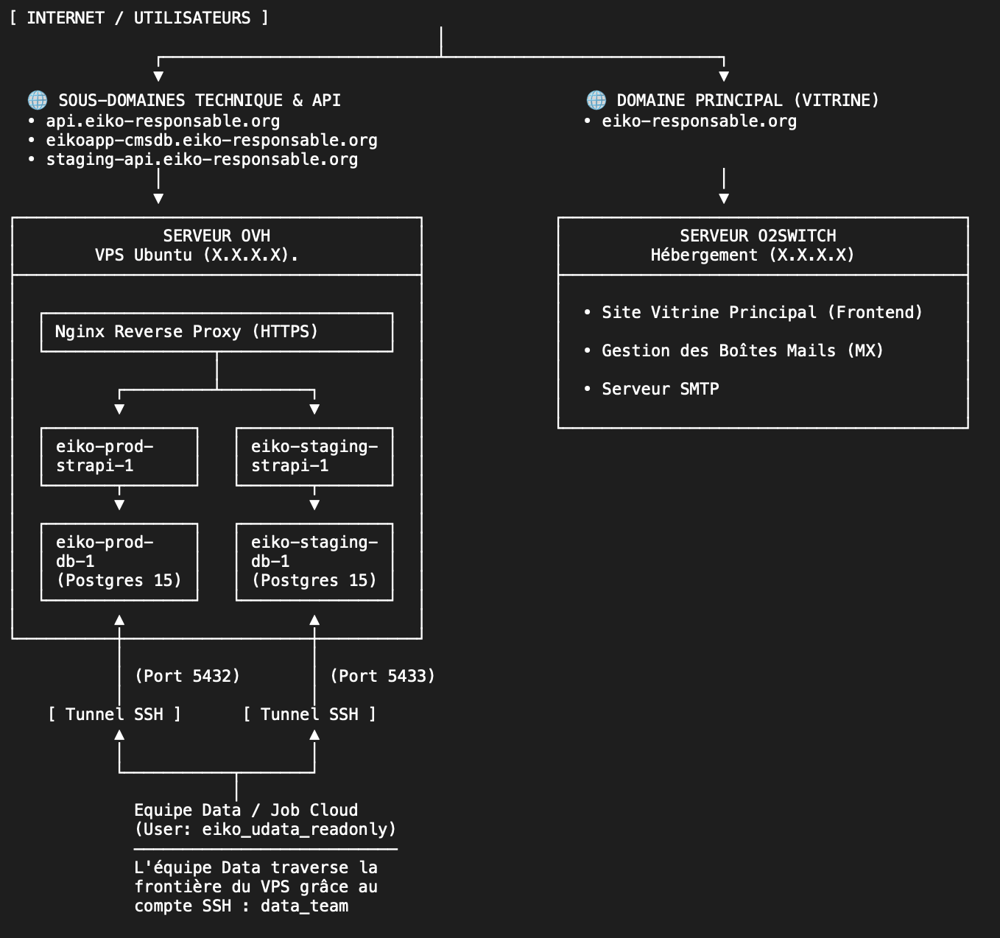

### Cathalina Ranaivoarison

### Ingénieur DevOps & Cloud

Ingénieur DevOps & Cloud spécialisé dans l'automatisation d'infrastructures, la CI/CD, Kubernetes, Terraform et AWS.

Passionné par la conception de plateformes cloud scalables, l'automatisation des déploiements et l'amélioration de la fiabilité des systèmes grâce aux pratiques DevOps.

### 🛠️ Tech Stack

---

# 💻 Projets 1

## Eiko – Citizen Engagement Platform (40,000+ Users)

### Présentation du Projet

Migration d'infrastructure mobile : transition d'un hébergement mutualisé historique (O2Switch) vers une architecture Cloud conteneurisée sur VPS OVH.

### Réalisations

- **Migration sans interruption (Zero-Downtime) :** Migration des charges de travail backend depuis un hébergement mutualisé (O2Switch) vers un VPS dédié OVH, opérée sans aucune coupure de l'API ni dégradation de l'expérience utilisateur sur mobile.
- **Conteneurisation et Isolation :** Conception, déploiement et isolation complète des environnements de Production et de Staging via Docker Compose et un reverse proxy Nginx sécurisé (certificats SSL automatisés Let's Encrypt).
- **Automatisation & CI/CD :** Conception et mise en œuvre de pipelines d'intégration et de déploiement continus (CI/CD) pour automatiser les flux de travail opérationnels, les déploiements de l'API et la gestion des builds.
- **Sécurisation des accès Data :** Mise en place d'un accès sécurisé par tunnels SSH (authentification par clés Ed25519/RSA sans mot de passe) combiné à un contrôle d'accès basé sur les rôles (RBAC) PostgreSQL pour fournir à l'équipe Data un accès strict en lecture seule au niveau des tables.
- **Observabilité et Supervision :** Configuration d'une stack Prometheus et Grafana pour le suivi des métriques système en temps réel et la création de dashboards de performance.
- **Excellence Opérationnelle :** Rédaction de la documentation technique de référence, automatisation des sauvegardes (dumps DB) et définition des procédures opérationnelles de reprise sur sinistre (rollback).

### Architecture

### Problématiques & Défis Techniques

*   **Limitation technique :** L'hébergement mutualisé initial limitait la scalabilité et ne permettait pas une isolation propre des environnements.
*   **Sécurité des données :** L'équipe Data avait besoin d'un accès direct à la base de données pour leurs outils d'analyse (ex: BigQuery) sans pour autant exposer les ports PostgreSQL publiquement sur Internet.
*   **Continuité d'activité :** Assurer le routage pour l'application mobile tout en maintenant temporairement les e-mails et le site vitrine sur l'ancien hébergeur.(Migration total à venir)

### Métriques & Impact Business

*   **100% de disponibilité (Zero-Downtime) :** Aucune coupure constatée pour les utilisateurs lors de la bascule de l'API.
*   **Déploiements accélérés et fiabilisés :** L'intégration du pipeline CI/CD sécurise les mises à jour et réduit drastiquement le droit à l'erreur humaine en production.
*   **Sécurité durcie :** Suppression des mots de passe pour les accès serveurs et isolation complète des bases de données.
*   **Observabilité :** Intégration d'une stack de supervision (Prometheus/Grafana) pour suivre l'état de santé du serveur en temps réel.

**Tech Stack du projet:** Docker • PostgreSQL • Strapi • Nginx • Grafana • Prometheus • Linux • Git • DNS

---
# 💻 Projets 2

## IC GROUP – Architecture CI/CD & Infrastructure Code Multi-Serveurs 

### Présentation du Projet
La société **IC GROUP** a mis en place un site web vitrine développé en Python/Flask servant de point d'entrée unique vers ses deux applications d'entreprise stratégiques :
1. **Odoo 13.0 (Édition Communautaire)** : Configuré et personnalisé avec son module LMS (Learning Management System) pour la gestion et la diffusion des formations internes.
2. **pgAdmin4** : Déployé pour assurer l'administration graphique et sécurisée de la base de données PostgreSQL d'Odoo.

L'objectif de ce projet a été de concevoir, provisionner et automatiser une infrastructure d'entreprise conteneurisée hautement disponible. Pour répondre aux besoins d'isolation des charges de travail et de sécurité, la solution est entièrement orchestrée et répartie de manière transparente sur **03 serveurs cloud distincts** (AWS EC2).

### Réalisations
* **Infrastructure as Code (IaC) :** Écriture et déploiement de scripts Terraform pour automatiser le provisionnement d'instances AWS EC2 (`t2.medium` et `t2.micro`) et la configuration dynamique des règles de pare-feu (Security Groups).
* **Gestion de Configuration et Provisioning :** Création de playbooks Ansible pour automatiser l'installation complète de l'écosystème Docker/Docker Compose sur des instances vierges.
* **Industrialisation par Rôles Ansible :** Modélisation de rôles Ansible hautement réutilisables (`odoo_role` et `pgadmin_role`) s'appuyant sur des templates Docker Compose configurés dynamiquement avec Jinja2 (volumes persistants, isolation réseau et services configurables).
* **Conteneurisation et Scripting Avancé :** Optimisation d'un Dockerfile Python/Flask utilisant des variables d'environnement dynamiques extraites à la volée via des scripts Linux (`awk`) à partir d'un fichier de configuration centralisé (`releases.txt`).
* **Pipeline CI/CD Unifié (Jenkins) :** Conception d'un pipeline complet structuré en étapes (Extraction, Multi-Build avec arguments, Tests fonctionnels automatisés via curl/inspect, Push Docker Hub et Déploiement automatique via Ansible).

### Architecture
L'infrastructure est segmentée sur **03 serveurs distincts** déployés sur AWS :
* **Serveur 1 (t2.medium)** : Dédié à l'orchestration CI/CD avec **Jenkins**.
* **Serveur 2 (t2.micro)** : Héberge l'application web **Site Vitrine** (port 8080) et **pgAdmin4** (port 5050).
* **Serveur 3 (t2.micro)** : Héberge l'application **Odoo 13.0** et sa base de données **PostgreSQL** (port 8069).

### Problématiques & Défis Techniques
* **Isolation et Optimisation des Ressources :** Odoo et PostgreSQL étant gourmands en ressources, le défi consistait à isoler l'ERP sur un serveur dédié tout en maintenant le site vitrine et pgAdmin sur une autre instance pour garantir la haute disponibilité du site institutionnel.
* **Dynamisation des Déploiements :** Permettre aux équipes produit de modifier les URLs de redirection ou la version de l'application sans jamais toucher au code source ou perturber la configuration réseau.
* **Stratégie Multi-Environnement :** Assurer la portabilité totale des recettes de déploiement Ansible afin de pouvoir basculer l'infrastructure d'un environnement Cloud (AWS EC2) vers du On-Premises sans modifier la logique des rôles.

### Métriques & Impact Business
* **Automatisation à 100% (Zero-Human-Error) :** Le provisioning complet (de la machine vide à l'application fonctionnelle) s'exécute de manière idempotente sans aucune action manuelle.
* **Livraison Continue Sécurisée :** Intégration de tests de validation (Health Checks HTTP et validation d'environnement) bloquant automatiquement le pipeline et empêchant l'application de passer en production en cas de crash.
* **Flexibilité Commerciale :** Réduction drastique du "Time-to-Market" pour le déploiement de nouvelles versions applicatives (v1.0 à v1.1) simplement en poussant un tag textuel.

**Tech Stack du projet :** AWS EC2 • Terraform • Ansible • Jenkins • Docker • Docker Compose • Python (Flask) • Odoo 13 • pgAdmin4 • Linux (Bash/Awk) • Git

---

## Repositories 🔭

- [Docker Deployments](https://github.com/CathalinaRanaivoarison/Docker)
- [Kubernetes Projects](https://github.com/CathalinaRanaivoarison/Kubernetes)
- [Jenkins CI/CD Pipelines](https://github.com/CathalinaRanaivoarison/Jenkins)
- [Ansible Automation](https://github.com/CathalinaRanaivoarison/Ansible)
- [Terraform AWS Infrastructure](https://github.com/CathalinaRanaivoarison/Terraform)

---
## 🎓 Certificat

- AWS Certified DevOps Engineer – Professional (in progress)
- Certified Kubernetes Administrator (CKA) (in progress)

---

## 📫 Contact

📧 cathalinaranaivoarison@gmail.com

💼 [LinkedIn](https://www.linkedin.com/in/cathalina-ranaivoarison-ingenieur-devops-cloud-cdi-paris)

📍 Paris, France

---

## ⚡ Fun Fact

I enjoy building automated cloud infrastructures and transforming manual operations into reliable CI/CD pipelines.

